<p align="center">
  <picture>
    <source media="(prefers-color-scheme: dark)" srcset="assets/branding/zynith-logo-on-dark.png">
    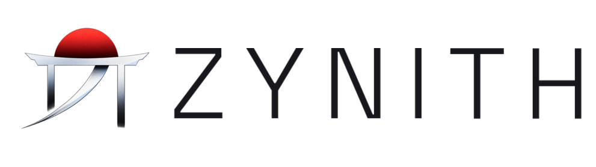
  </picture>
</p>

<p align="center"><em>For the pursuit of elegance and freedom.</em></p>

<p align="center">
  A desktop shell for the <a href="https://github.com/YaLTeR/niri">niri</a> Wayland compositor: bars, panels,
  notifications, a launcher and a Settings app, in one calm design language.
</p>

<p align="center">
  <a href="#download-zynith">Download</a> ·
  <a href="#screenshots">Screenshots</a> ·
  <a href="#features">Features</a> ·
  <a href="#official-configurations">Configurations</a> ·
  <a href="docs/README.md">Documentation</a> ·
  <a href="CONTRIBUTING.md">Contributing</a>
</p>

---

<p align="center">
  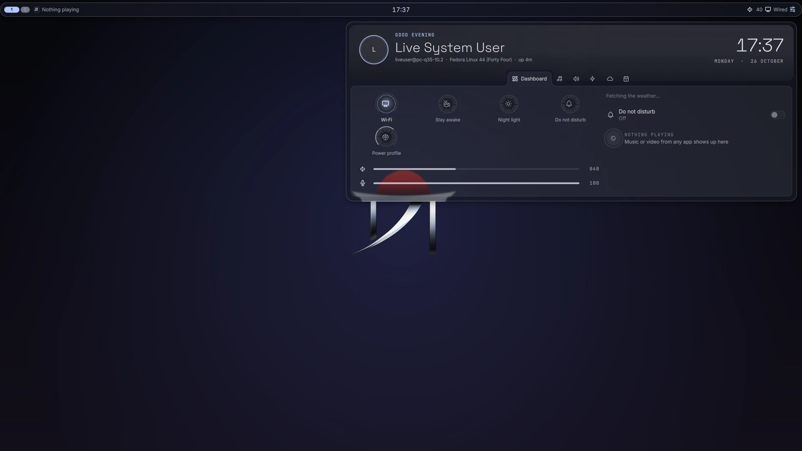
</p>

Zynith turns niri into a complete desktop. Every surface — bars, the Zynith Island, the Control Panel, the launcher,
notifications, on-screen displays, desktop widgets, the lock screen — follows one set of materials, motion and type,
and everything is configured from one Settings app.

- **Calm and coherent.** Glass, solid or frosted surfaces; motion that is measured, not guessed.
- **Cheap to run.** Nothing polls; surfaces that are not on screen do no work; the desktop spends less on battery and
  with power saver on.
- **Yours to shape.** Bars on any edge, a visual bar editor, curated official configurations, and plain TOML files
  underneath.
- **Private by default.** No telemetry, no accounts, and no network requests unless you turn a feature on
  ([what is sent, and when](SECURITY.md#network-services)).

> **Status: pre-release, 0.1.0 in development.** Zynith is usable day to day on Fedora 44, but configuration may still
> change between versions and the ISO is not yet validated for installation. There is no stable release yet.

## Download Zynith

| Path | For | State |
|---|---|---|
| [The Zynith ISO](#the-zynith-iso) | a new machine, or trying Zynith in a virtual machine | **experimental — not yet recommended for installation** |
| [Packages on Fedora + niri](#existing-fedora--niri-users) | an existing Fedora 44 installation | built from source; no package repository yet |
| [From source](#from-source-for-developers) | developers | supported |

Zynith supports **Fedora Linux 44 on x86_64**, with niri 26.04 and Quickshell 0.3.1.

### The Zynith ISO

A live and installable Fedora 44 image with niri and Zynith, installed with Fedora's own installer (Anaconda), which
asks before changing any disk. **No ISO has been published yet.** It is built from this repository and is being
validated in virtual machines; see the [validation status](docs/development/iso.md#validation-status).

```sh
iso/build-iso.sh                 # needs rootless podman and QEMU/KVM; about 40 GB free space
iso/test-vm.sh live              # boot it in a virtual machine, without installing anything
sha256sum -c build/release/iso/zynith-*.iso.sha256
```

[The ISO](docs/development/iso.md) explains verifying a download, writing a USB stick, testing safely, installing,
recovery and hardware notes.

### Existing Fedora + niri users

```sh
packaging/rpm/build-rpms.sh      # builds the packages in a Fedora 44 container
sudo dnf install build/release/repo/{zynith-desktop,zynith-ui,zynith-shell,quickshell,cpptrace}-*.rpm
```

Then choose the **Zynith** session at the login screen. Your existing files are never replaced; see
[Packaging](docs/development/packaging.md).

### From source (for developers)

```sh
git clone https://github.com/adhitya-zynastra/Zynith-Shell.git zynith && cd zynith
deploy/install.sh --shell        # builds and installs into your home directory only
```

[Building and running](docs/development/building.md) covers the requirements, starting Zynith from niri and
recovering a session that does not start.

## Screenshots

| | |
|---|---|
| 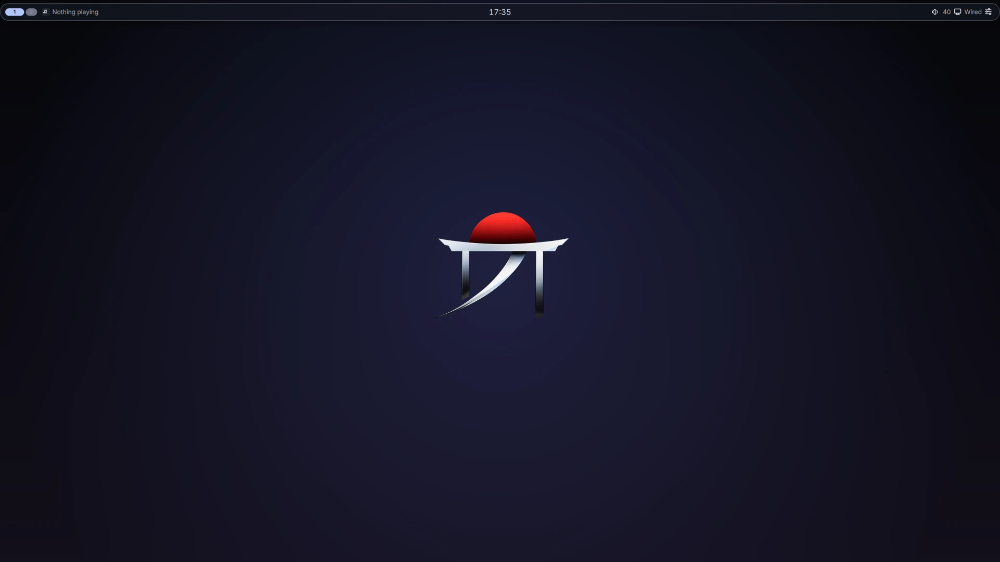 | 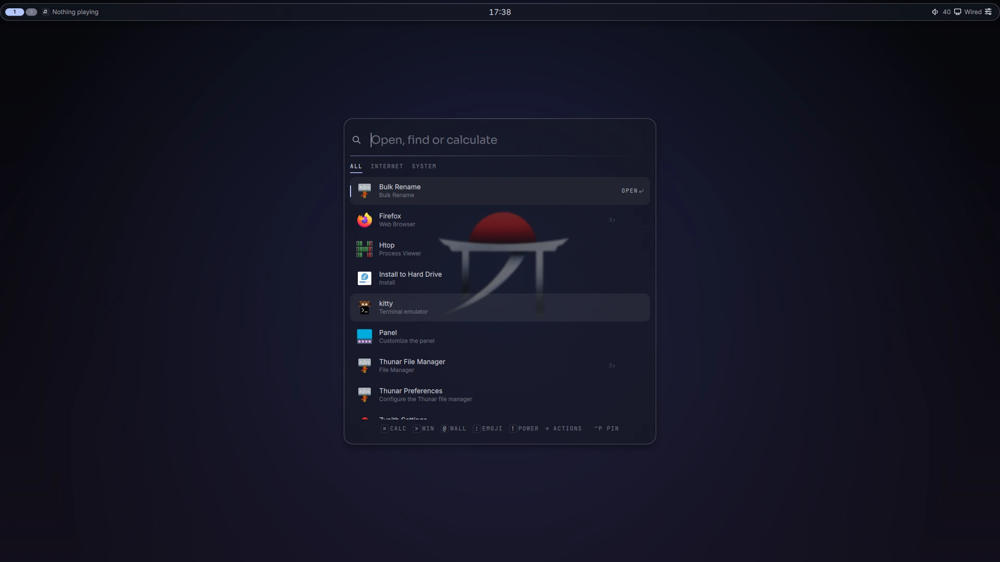 |
| **Desktop** — one bar, the default wallpaper | **Launcher** — applications, calculator, emoji, windows, wallpapers |
| 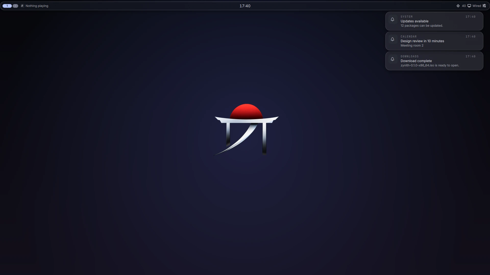 | 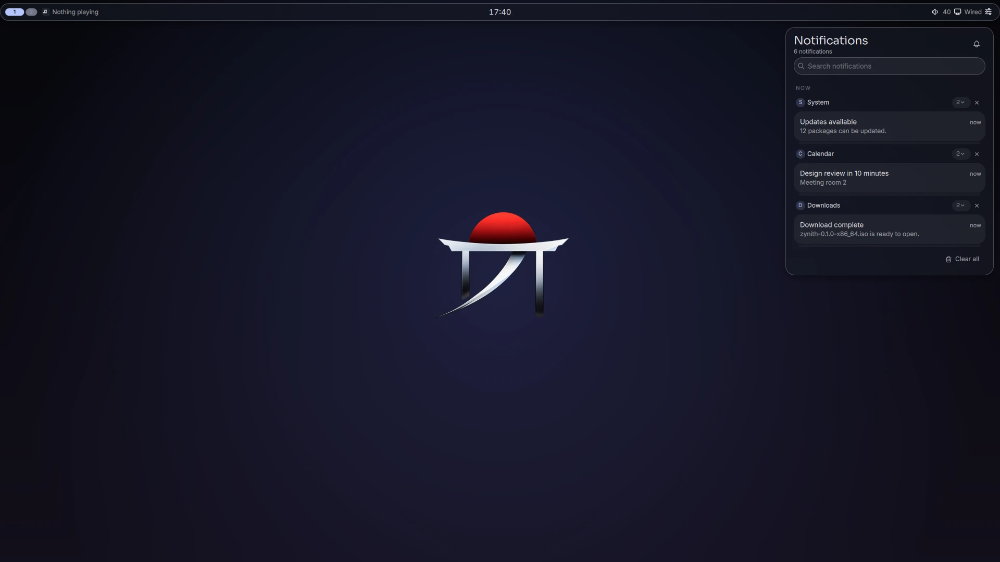 |
| **Notifications** — popups at the top right | **Notification centre** — grouped by app, searchable |
| 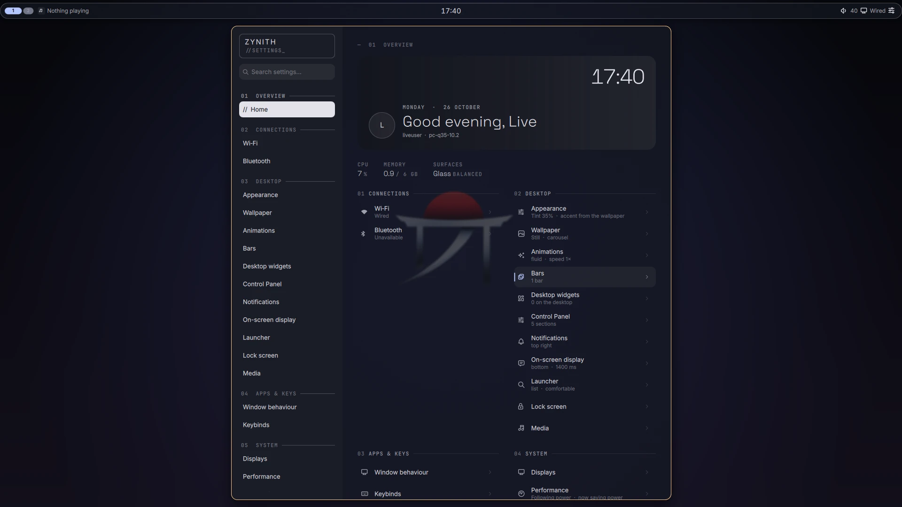 | 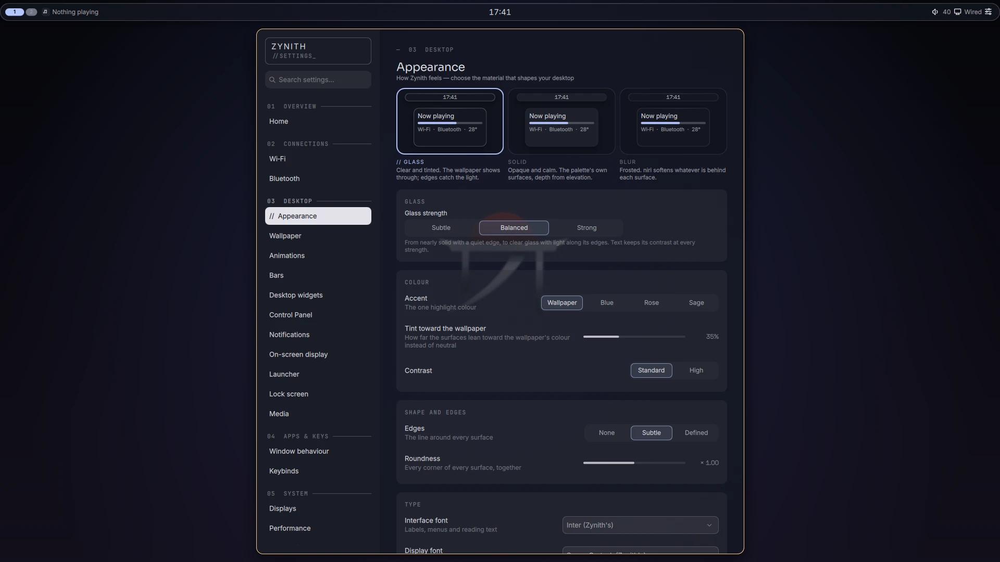 |
| **Settings** — every option in one app | **Appearance** — the surface material, colour, shape and type |
| 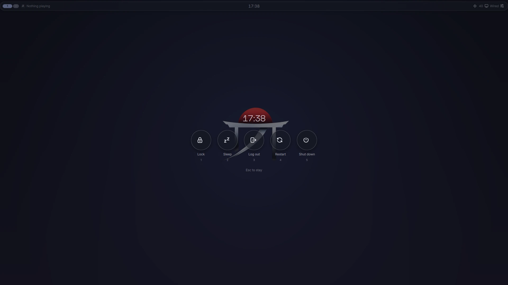 |  |
| **Session menu** — lock, sleep, log out, restart, shut down | **Control Panel** — quick settings, audio, media, notifications |

These are unedited captures of the live ISO's session (1920×1080, in a virtual machine), with the default
configuration and test notifications.

## Features

| Feature | What it does | State |
|---|---|---|
| **Bars** | any number, on any edge; a visual editor and ready-made layouts | stable |
| **Zynith Island** | a bar component that takes the shape of what is happening | stable |
| **Control Panel** | media, audio, network, Bluetooth, power, calendar and weather; per-icon panels from the bar | stable |
| **Launcher** | applications, calculator, emoji, windows, wallpapers and power actions | stable |
| **Notifications** | popups and a notification centre, grouped, with do-not-disturb and inline replies | stable |
| **On-screen displays** | volume, brightness and other keys | stable |
| **Desktop widgets** | clock, media, weather, visualiser and more, placed with an editor | stable |
| **Lock screen** | PAM authentication, the same design language | stable |
| **Materials and profiles** | Glass, Solid and Blur surfaces; less work on battery and power saver | stable |
| **Settings** | one app for every option, with live previews | stable |
| **Live (animated) wallpapers** | need a separately built renderer, not packaged | experimental |
| **Native shell plugins** | Luau plugins from sources you add | experimental |
| **The Zynith ISO** | live and installable Fedora 44 image | experimental |

"Stable" means it is used every day and covered by tests where it can be; Zynith as a whole is pre-release.
[Using Zynith](docs/user/using.md) lists the key bindings and how each part works.

## Official configurations

Four curated starting points for how Zynith looks and how much it spends:

| | Look | Resource use |
|---|---|---|
| **Zynith Glass** | clear, tinted glass; the default | follows power |
| **Zynith Solid** | opaque surfaces, defined edges | follows power |
| **Zynith Minimal** | opaque, borderless, short motion | saves even when plugged in |
| **Zynith Max Experience** | frosted, compositor-blurred surfaces | keeps effects on battery; needs a capable GPU |

| | |
|---|---|
| 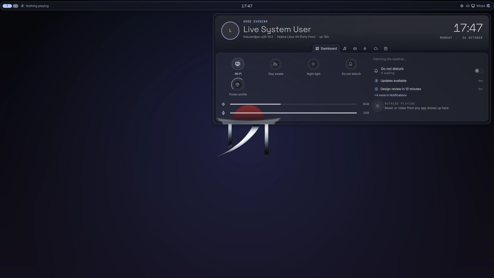 | 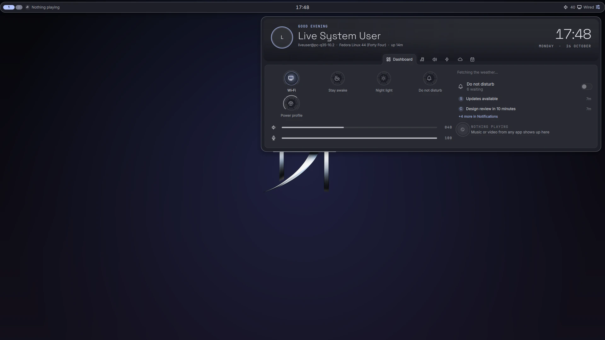 |
| **Glass** — the wallpaper shows through | **Solid** — opaque, defined edges |
| 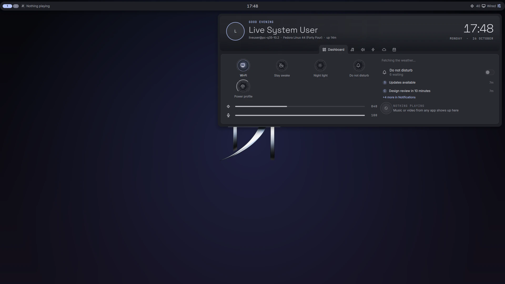 | 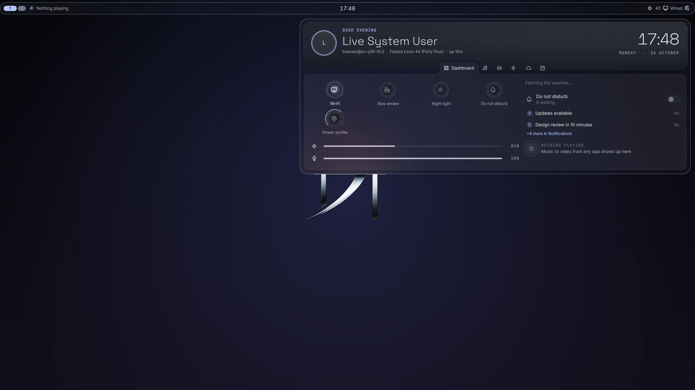 |
| **Minimal** — opaque, borderless | **Max Experience** — frosted by the compositor |

```sh
zynith-config list
zynith-config show minimal       # preview the change
zynith-config apply minimal      # only the keys it sets change; your files are backed up first
zynith-config restore            # undo
```

From a source checkout, run `configs/official/zynith-config.py` in place of `zynith-config`.

They live in [`configs/official/`](configs/official/); [Configuring Zynith](docs/user/configuring.md) explains them
and every configuration file.

## How it is built

| Part | Role | Technology |
|---|---|---|
| **niri** | compositor and window manager (unmodified) | Rust, Wayland |
| **Zynith UI** ([`ui/`](ui/)) | everything you see and touch | Quickshell (QML) and a C++ plugin |
| **Native shell** ([`src/`](src/)) | services, lock screen, wallpaper, theme engine, IPC | C++23, Wayland, OpenGL ES |
| **zynith-ui** | starts and supervises both, routes key bindings | bash |

More in [Architecture](docs/development/architecture.md).

## Documentation

- **Users:** [using](docs/user/using.md) · [configuring](docs/user/configuring.md) ·
  [troubleshooting](docs/user/troubleshooting.md) · [the ISO](docs/development/iso.md)
- **Developers:** [architecture](docs/development/architecture.md) · [building](docs/development/building.md) ·
  [testing](docs/development/testing.md) · [packaging](docs/development/packaging.md) ·
  [releases](docs/development/releases.md)

## Contributing and support

Bug reports and contributions are welcome — read [CONTRIBUTING](CONTRIBUTING.md) first. Help: [SUPPORT](SUPPORT.md).
Security problems: [SECURITY](SECURITY.md), never a public issue. Everyone taking part follows the
[Code of Conduct](CODE_OF_CONDUCT.md).

## Licence and credits

Zynith is free software under the **GNU General Public License v3.0 only** ([`LICENSE`](LICENSE)).

The native shell includes MIT-licensed code from the shell it was first built from; that notice is kept in
[`LICENSES/`](LICENSES/), and its authors are credited in [CREDITS](CREDITS.md). Vendored code in
[`third_party/`](third_party/) keeps its own licences. The UI's fonts (Inter, Space Grotesk, Sora) are under the SIL
Open Font License; icons are Tabler Icons (MIT).
